<div align="center">

# Pramāṇa

### A study companion that proves every claim

*Pramāṇa* (Sanskrit, प्रमाण): a means of valid knowledge, that which justifies a belief.

Pramāṇa unifies **lecture videos, slide decks and textbooks** into one source-cited knowledge base,
tutors from it with **citations you can click and check**, generates **verified** quizzes and mock
exams, and keeps a **learner model** of what each student knows.

</div>

---

## Contents

1. [The idea in one paragraph](#1-the-idea-in-one-paragraph)
2. [Feature overview](#2-feature-overview)
3. [How the challenge requirements map to the code](#3-how-the-challenge-requirements-map-to-the-code)
4. [System architecture](#4-system-architecture)
5. [The course material](#5-the-course-material)
6. [Ingestion pipeline](#6-ingestion-pipeline)
7. [Retrieval](#7-retrieval)
8. [Grounded tutoring: the quote-lock method](#8-grounded-tutoring-the-quote-lock-method)
9. [Assessment engine](#9-assessment-engine)
10. [Learner model](#10-learner-model)
11. [Revision tools: schedule, flashcards, voice, languages](#11-revision-tools-schedule-flashcards-voice-languages)
12. [The web app](#12-the-web-app)
13. [Data model](#13-data-model)
14. [Model roles and providers](#14-model-roles-and-providers)
15. [Installation and setup](#15-installation-and-setup)
16. [Configuration reference](#16-configuration-reference)
17. [Command-line reference](#17-command-line-reference)
18. [HTTP API reference](#18-http-api-reference)
19. [Evaluation](#19-evaluation)
20. [Testing](#20-testing)
21. [Repository layout](#21-repository-layout)
22. [Security and privacy notes](#22-security-and-privacy-notes)
23. [Troubleshooting](#23-troubleshooting)
24. [Known limitations](#24-known-limitations)
25. [Roadmap](#25-roadmap)
26. [Licences and credits](#26-licences-and-credits)

---

## 1. The idea in one paragraph

General AI chatbots answer from anywhere and cite nothing, so a student cannot tell a correct answer
from a confident wrong one. Pramāṇa follows one rule: **nothing reaches the student unless a
mechanical check has passed.** Citations are checked by string matching against the source text.
Answer keys are checked by a second model that solves the question blind and, for numerical
questions, by executed code. Mastery estimates come from a Bayesian model whose behaviour is checked
against simulated students with known ground truth. Where the course material does not cover a
question, Pramāṇa says so instead of improvising.

---

## 2. Feature overview

| Area | What Pramāṇa does |
|---|---|
| **Multimodal ingestion** | YouTube lectures (captions with timestamps), slide PDFs (including 4-up handouts, split automatically), textbook PDFs, local video files (optional speech-to-text). No manual preprocessing. |
| **Exact origins** | Every unit of content keeps its page number, slide number or video timestamp, and opens there with one click. |
| **Figure understanding** | A vision model describes every diagram, plot and table on slides and textbook pages; each description becomes a searchable, citable unit, clearly labelled as an AI reading. |
| **Triangulated sources** | Each slide is aligned to the moment it is discussed in its lecture video, so one concept opens as slide, video and textbook page. |
| **Concept map** | Topics, subtopics and concepts with definitions, prerequisites and common misconceptions; every unit is tagged to concepts; prerequisite links the teaching order contradicts are dropped. |
| **Grounded tutor** | Answers split into lanes: *source-backed* (with verbatim quotes checked in code), *outside knowledge* (visibly separate) and *unverified* (a claimed quote that failed the check). |
| **Refusal** | Off-topic questions are declined before any model call; in-domain questions the material does not cover are declined by the model's coverage judgement. |
| **Verified assessment** | Multiple-choice, numerical and short-answer questions; each passes a gate of structural, quote, executed-code, cross-model and novelty checks before it can be served. |
| **Misconception diagnosis** | Every wrong option is written from a named misconception, so a wrong answer identifies a wrong belief. |
| **Three assessment modes** | Quiz (feedback after each answer), timed mock exam (feedback at the end), adaptive diagnostic (each answer picks the next question). |
| **Reports** | Mastery before and after per concept, scores by topic, likely misconceptions, root causes traced to weak prerequisites, and the best place in the course to study next. |
| **Learner model** | Prerequisite-aware Bayesian knowledge tracing with forgetting, updated after every quiz answer and every tutor check question. |
| **Cold start** | Three-question intake sets a prior; an adaptive diagnostic replaces it with measured estimates. |
| **Revision** | Course flow map coloured by mastery, cited flashcards for weak concepts, a study schedule up to the exam date. |
| **Languages and voice** | Explanations in English, Hindi or Hinglish over English sources (quotes stay verbatim); speech input and read-aloud in the browser. |
| **Evaluation built in** | Retrieval and refusal metrics, RAGAS generation metrics, and a simulated-student study, all shown on an in-app Evaluation page with their caveats. |

---

## 3. How the challenge requirements map to the code

| Requirement | Where it is met |
|---|---|
| 1a Ingest videos, textbooks, slides without manual preprocessing | `ingest/parse.py`: `parse_youtube`, `parse_media_file`, `parse_slides` (automatic handout detection), `parse_textbook` |
| 1b Topics, concepts, prerequisites; every unit linked to its origin | `ingest/enrich.py`: `build_concept_graph`, `validate_prerequisites`; `units.loc_type/loc_start/loc_end` in `db.py` |
| 1c Tag every content unit to topics and concepts | `ingest/enrich.py`: `tag_units` (every unit gets at least its best match) |
| 1d Use images, diagrams and figures | `ingest/enrich.py`: `describe_figures` creates `figure` units |
| 2a Cited excerpts that open the exact page, slide or timestamp | `grounding.py`: quote-lock; `service.py`: `unit_view` builds the open target; `SourceViewer.jsx` |
| 2b Decline or flag uncovered queries; separate outside knowledge | `grounding.py`: `coverage_gate`, the `coverage` field, `outside` and `unverified` lanes |
| 3a Quizzes and mock exams (MCQ, short, numerical), tagged by topic, source, difficulty | `assess/generate.py`: `create_assessment`, `make_question`; tags in `public_question` |
| 3b Verify correctness; avoid repeats | `assess/verify.py`: `verify`; `assess/sandbox.py`; `_unseen` and the novelty check |
| 3c Cited feedback and a report with weak topics and misconceptions | `assess/report.py`: `submit_answer`, `build_report` |
| 4a Per-topic mastery updated after every quiz and conversation | `learner.py`: `LearnerModel.observe`; called from `assess/report.py` and `grounding.py` |
| 4b New students with no history | Intake in `App.jsx`, `LEVEL_PRIORS` in `learner.py`, diagnostic mode in `assess/generate.py` |
| 5a Standard evaluation framework | `eval/run_ragas.py` (RAGAS) |
| 5b Faithfulness, relevancy, context precision and recall on a team-built test set | `eval/testset.json`, `eval/run_ragas.py`, `eval/run_retrieval_eval.py` |
| 5c Simulated students over sessions: mastery gains, repetition rate | `eval/simulate.py` |
| 6a Course flow map | `Dashboard.jsx`: `ConceptMap` |
| 6b Revision material for weak topics | `extras.py`: `flashcards` (with read-aloud) |
| 6c Study schedule from weak topics, forgetting and exam date | `learner.py`: `schedule`; `extras.py`: `study_schedule` |
| 6d Indian-language interaction | Student language setting (`en`, `hi`, `hinglish`) used in `grounding.py` and `extras.py` |
| 6e Audio tutoring | Browser speech recognition and synthesis in `Tutor.jsx`, `Dashboard.jsx`, `api.js` |

---

## 4. System architecture

### 4.1 Components

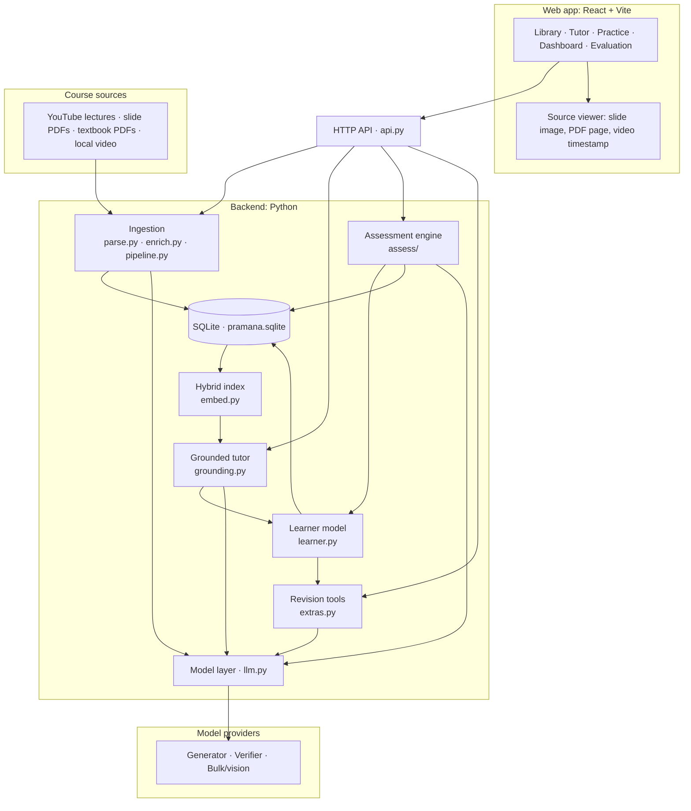

### 4.2 Layers

| Layer | Module(s) | Responsibility | Uses an LLM? |
|---|---|---|---|
| Configuration | `config.py` | Paths, environment variables, defaults | No |
| Persistence | `db.py` | SQLite schema, thread-safe connection, key-value store | No |
| Model access | `llm.py` | Three roles, two providers, JSON schemas, disk cache | It *is* the LLM boundary |
| Parsing | `ingest/parse.py` | Turn sources into verbatim units with origins | No |
| Enrichment | `ingest/enrich.py` | Figures, slide-video alignment, concept graph, tagging, prerequisite validation | Figures and graph only |
| Orchestration | `ingest/pipeline.py` | Fetch, parse, store, enrich; manifest handling; auto-pairing | No |
| Retrieval | `embed.py` | Local embeddings, BM25, rank fusion, rare-term lookup | No |
| Shared services | `service.py` | Unit views with open targets, graph and learner loading, persistence of updates | No |
| Tutor | `grounding.py` | Query rewrite, coverage gate, lane generation, quote-lock, chat evidence | Yes |
| Assessment | `assess/generate.py`, `verify.py`, `sandbox.py`, `report.py` | Generate, verify, serve, grade, report | Yes (generation, verification, short-answer grading) |
| Learner model | `learner.py` | BKT, prerequisites, forgetting, selection, diagnosis, schedule | No |
| Revision | `extras.py` | Flashcards, study schedule | Flashcards only |
| API | `api.py` | REST endpoints, background jobs, static hosting | No |
| CLI | `cli.py` | `ingest`, `enrich`, `bank`, `stats`, `serve` | No |
| Web app | `frontend/src/` | Five pages and the source viewer | No |

**Design principle:** every step that can be done without a language model is done without one.
Parsing, retrieval, alignment, the refusal gate, quote checking, answer recomputation, grading of
multiple-choice and numerical answers, the learner model and the schedule are all deterministic code.

### 4.3 End-to-end flow

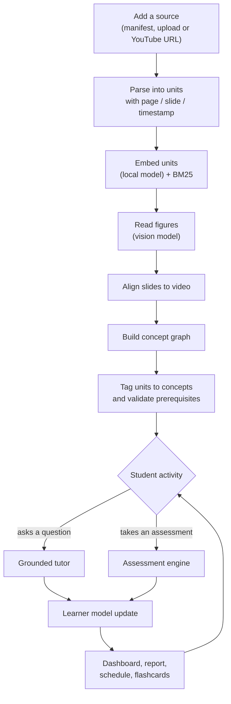

---

## 5. The course material

The default course is defined in [`course.yaml`](course.yaml) and fetched over HTTP at ingest time.
Nothing is bundled in the repository.

| Source | Content | How it is fetched |
|---|---|---|
| MIT OCW 6.041SC lecture videos 1-8 | Probability models, conditioning and Bayes, independence, counting, discrete random variables I-III, continuous random variables | YouTube captions with timestamps |
| MIT OCW 6.041SC lecture slides 1-8 | The matching slide decks (4-up handouts) | Direct PDF download |
| Grinstead and Snell, *Introduction to Probability*, chapters 1-6 (PDF pages 9-292) | Discrete and continuous probability, combinatorics, conditional probability, distributions, expectation and variance | Direct PDF download |

After ingestion (before figure reading): **17 sources, 996 units** (65 slides, 520 textbook units,
411 transcript windows) and **65 slide-to-video links**.

Each manifest entry has an `id`, a `kind` (`video`, `slides` or `textbook`), a `title`, and either a
`youtube` id or a `url`. An optional `group` pairs a slide deck with its lecture video, and `pages`
limits a textbook to a page range:

```yaml
- {id: L02-video,  kind: video,  group: L02, title: "Lecture 2: Conditioning and Bayes' Rule", youtube: TluTv5V0RmE}
- {id: L02-slides, kind: slides, group: L02, title: "Lecture 2 slides", url: "https://ocw.mit.edu/.../MIT6_041SCF13_L02.pdf"}
- {id: textbook,   kind: textbook, title: "Grinstead & Snell, Introduction to Probability", url: "https://math.dartmouth.edu/~prob/prob/prob.pdf", pages: [9, 292]}
```

To use a different course, edit `course.yaml` or upload sources from the Library page.

---

## 6. Ingestion pipeline

### 6.1 Overview

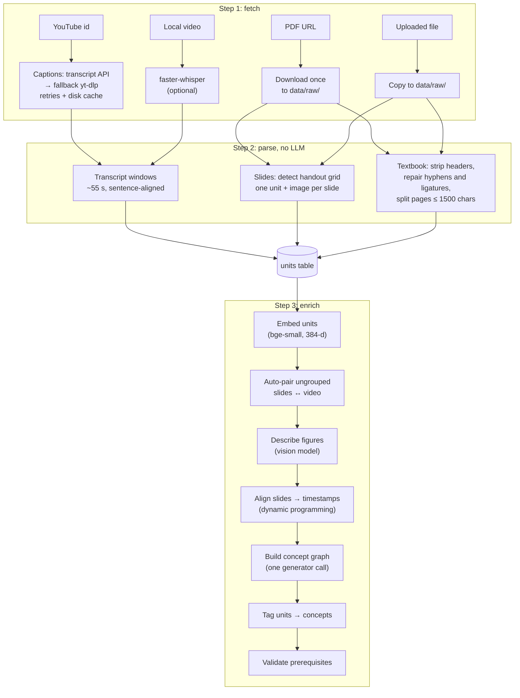

Stages that need a model (`E3`, `E5`) are **skipped with a logged warning** when no key is
configured, so the rest of the pipeline still runs. `ingest` is idempotent: sources already in the
database are skipped, captions and PDFs are cached on disk, and every model call made during
ingestion is cached by a hash of its inputs (`data/cache/`), so re-running is cheap.

### 6.2 Units: the citable building block

A **unit** is the smallest piece of content that can be cited.

| Unit kind | Produced from | `loc_type` | Location stored | Text is |
|---|---|---|---|---|
| `transcript` | Video captions | `time` | start and end seconds | verbatim captions |
| `slide` | One slide | `slide` | slide number (plus PDF page in metadata) | verbatim PDF text |
| `text` | Part of a textbook page | `page` | PDF page number | verbatim PDF text |
| `figure` | A diagram on a slide or page | same as its parent | same as its parent | **AI description** (marked `derived`) |

Figure units are the only units whose text is not the author's own words. They are flagged
`derived: true`, and the viewer shows the original image above them with a warning.

### 6.3 Videos

- `parse_youtube` tries the YouTube transcript API first (English preferred, any language as a
  fallback). If it is rate-limited, it falls back to `yt-dlp`'s caption download (`json3` format).
  Four attempts alternate the two routes with growing back-off (4, 8, 12, 16 s). A successful fetch
  is cached as `data/raw/<video_id>.captions.json`, so a video is never fetched twice.
- `chunk_transcript` groups caption snippets into windows of about **55 seconds**, closing a window at
  the end of a sentence once 55 s have passed, or unconditionally at 88 s. Bracketed cues like
  `[MUSIC]` are dropped.
- Local video or audio files go through `faster-whisper` (model `small`, int8, voice-activity
  filtering) when that optional package is installed.

### 6.4 Slide decks and automatic handout detection

Lecture slides are often distributed as handouts with several slides tiled on each page. Pramāṇa
detects this from the page geometry:

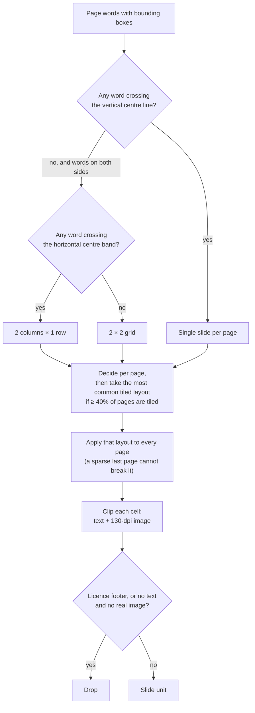

Text cleaning repairs hyphenated line breaks, ligatures (`fi` → `fi`), soft hyphens and bullet glyphs
split onto their own line.

### 6.5 Textbooks

`parse_textbook` processes a page range. For each page it removes the running header (a short
all-caps title line and/or a bare page number), cleans the text, and splits pages longer than
**1,500 characters** at line boundaries. Every part keeps the page number. Pages containing a figure
caption (`Figure 3.2:`) or an embedded image are rendered at 100 dpi and marked for figure reading.

### 6.6 Figure understanding

`describe_figures` sends each slide image, and each textbook page with a figure (capped by
`PRAMANA_MAX_FIGURE_PAGES`, default 60), to the **bulk** model. The prompt asks it to describe
only what is visibly there: what is drawn, axis and node labels, numbers shown, and the idea
illustrated, with no outside facts. Each figure becomes a `figure` unit at the same location as its
parent, ordered right after it, and is then embedded like any other unit. Processed units are marked
`vision_done`, so re-running skips them.

### 6.7 Slide-to-video alignment

Slides are shown in order during a lecture, so the alignment is a **monotone assignment** problem.
For slides $s_1 \ldots s_n$ and transcript windows $w_1 \ldots w_m$ with cosine similarity
$\text{sim}(i, j)$, Pramāṇa finds the non-decreasing assignment $a(1) \le a(2) \le \dots \le a(n)$
that maximises

$$\sum_{i=1}^{n} \widetilde{\text{sim}}\big(i, a(i)\big), \qquad \widetilde{\text{sim}}(i,j) = \text{sim}(i,j) + 0.5\,\text{sim}(i,j+1)$$

The smoothing term reflects that a slide stays on screen across neighbouring windows. The optimum
is found by dynamic programming in $O(nm)$ and stored as `shown_at` links with their similarity
score. The viewer shows a link as "the same moment in other sources" when its score is at least 0.45.

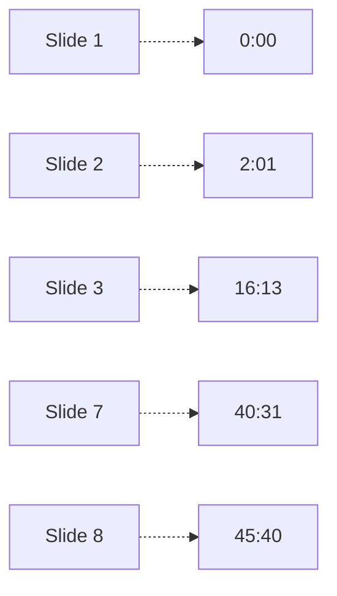

*(Real alignment for Lecture 2: every slide maps to a later-or-equal timestamp than the one before.)*

Decks uploaded without a `group` are **auto-paired** with the video whose mean embedding is most
similar, if that similarity exceeds 0.80 and the video is not already paired.

### 6.8 Concept graph

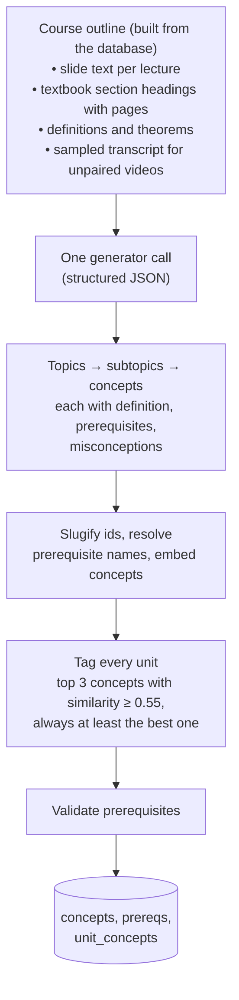

The generator is asked for 4-10 topics and 25-45 concepts, listed in teaching order, using the
material's own terms, with only direct prerequisites and one to three common misconceptions each.

**Prerequisite validation** (`validate_prerequisites`) then checks the model's edges against the
material:

1. For each concept, find where it is first taught: the earliest unit tagged to it with similarity
   at least 0.6.
2. Keep an edge "B requires A" only if A is taught no later than B (or, without strong tagging
   evidence, only if A is listed earlier).
3. Drop any edge that would close a cycle.
4. Store the counts (proposed, kept, dropped as taught-later, dropped as cyclic), shown by
   `python -m pramana.cli stats` and the API.

Rebuilding the graph keeps existing mastery for every concept whose id is unchanged.

---

## 7. Retrieval

`embed.py` keeps an in-memory index rebuilt from SQLite (about a thousand units, so this is instant).

| Signal | Implementation |
|---|---|
| Dense | `fastembed` with `BAAI/bge-small-en-v1.5` (ONNX, 384 dimensions, runs locally on CPU); query and passage embeddings normalised, cosine similarity |
| Lexical | BM25 (`rank-bm25`) over lower-cased word tokens with a small stop-word list |
| Fusion | Reciprocal rank fusion: $\text{score}(u) = \sum_{r \in \lbrace \text{dense},\, \text{bm25} \rbrace} \frac{1}{60 + \text{rank}_r(u)}$ |
| Output | Top 8 units, each with its fused score (for ordering) and its dense cosine (for the coverage gate) |

Dense-only and BM25-only modes exist for the ablation in the evaluation. The index also keeps
document frequencies for the **rare-term** check used by the coverage gate (§8.2).

---

## 8. Grounded tutoring: the quote-lock method

### 8.1 One chat turn

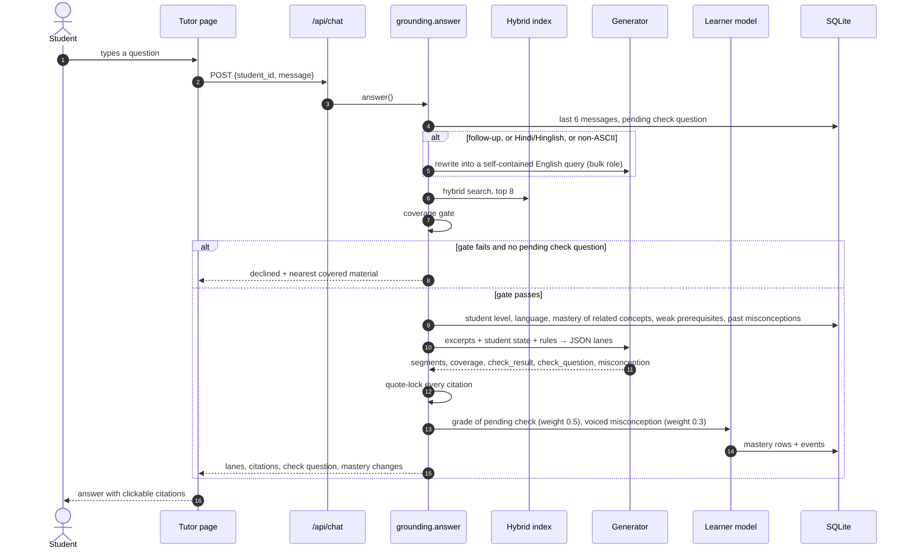

### 8.2 The coverage gate (first refusal layer)

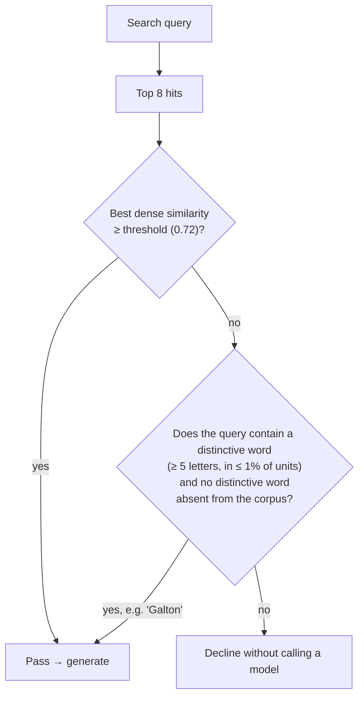

The gate is deliberately permissive: it is tuned never to block an answerable question, and it
catches off-topic queries. In-domain questions the material does not cover usually pass it and are
caught by the **second layer**, the generator's own `coverage: "none"` judgement. The rare-term rule
exists because some answerable questions match weakly by embedding ("What is a Galton board?" has a
best similarity of only 0.54) but contain a word the course clearly uses.

### 8.3 Generation in lanes

The generator returns structured JSON:

```json
{
  "coverage": "full | partial | none",
  "segments": [
    {"lane": "source",  "text": "…", "citations": [{"unit_id": 120, "quote": "verbatim 8-40 words"}]},
    {"lane": "outside", "text": "…", "citations": []}
  ],
  "concept_ids": ["total-probability-theorem"],
  "check_result": "correct | partial | incorrect | not_an_answer",
  "check_question": {"question": "…", "expected_answer": "…", "concept_id": "…"},
  "misconception": "a short sentence, or null"
}
```

Rules given to the generator include: every claim in a `source` segment must be supported by the
excerpts and carry a character-for-character quote; outside knowledge goes in an `outside` segment,
sparingly, and never to answer an uncovered question; adapt to the student state (bridge a weak
prerequisite first, match depth to level, confront a known misconception); reply in the student's
language but keep quotes in the source language; plain text with Unicode maths.

### 8.4 The quote check

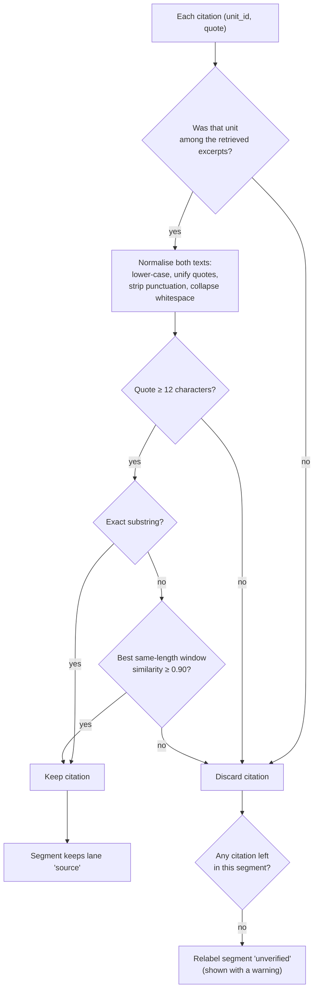

The 0.9 fuzzy allowance tolerates caption line breaks and PDF ligatures without accepting
paraphrase. **Guarantee:** a citation shown to the student points at text that exists at that page,
slide or timestamp. **Not guaranteed:** that every inference drawn from the quote is sound; RAGAS
faithfulness measures that.

### 8.5 What the student sees

| Lane | Appearance | Meaning |
|---|---|---|
| `source` | Indigo left border, citation chips | Every quote checked against the source |
| `outside` | Amber dashed box, "Outside your material · not source-backed" | General knowledge, kept separate |
| `unverified` | Red dashed box, "Unverified · no quote matched the cited source" | The model claimed a source but the check failed |
| Declined | Amber card with the score, the threshold and the nearest covered material | Not answered from the course; a button offers an answer from general knowledge, rendered entirely in the outside lane |

Clicking a citation opens the **source viewer**: the slide image, the textbook PDF at the exact
page, or the YouTube video at the exact second, with the quoted passage highlighted in the unit text
and links to the same moment in other sources.

### 8.6 Conversations as evidence

When an answer teaches something testable, the tutor ends with a **check question**. It is stored
as pending; if the student's next message answers it, the generator grades it (`correct`, `partial`,
`incorrect`) and the learner model updates at **weight 0.5**. A misconception the student voices in
chat counts as soft negative evidence at **weight 0.3**, without a learning transition.

---

## 9. Assessment engine

### 9.1 Generating and verifying one question

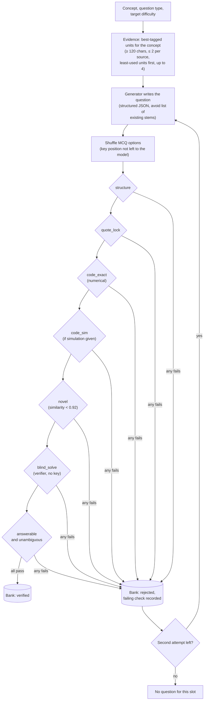

The cheap checks run first; the verifier model is only called when they pass.

| Check | Applies to | How it works |
|---|---|---|
| `structure` | all | Stem longer than 15 characters; MCQ has 4 distinct options and exactly one key; numerical has a finite answer; short answer has a model answer |
| `quote_lock` | all | The question's `source_quote` is found in the cited unit (same check as the tutor) |
| `code_exact` | numerical (and numeric MCQ) | Generator-written `exact()` runs in the sandbox and must reproduce the key within tolerance; a numerical question without code fails |
| `code_sim` | when `simulate(rng, n)` is given | 200,000 Monte Carlo trials must agree with the key within 4 standard errors for a probability, or 3% otherwise |
| `novel` | all | Cosine similarity of the stem to every verified question on the concept is below 0.92 |
| `blind_solve` | all | The **verifier** model solves the question without the key; MCQ must pick the same letter, numerical must agree within tolerance, short answer is judged equivalent by the verifier |
| `answerable` | all | The verifier judges it answerable from the excerpt and unambiguous |

**Question types**

| Type | Student enters | Graded by |
|---|---|---|
| Multiple choice | one of four options | code: index comparison; a wrong option returns its misconception tag |
| Numerical | a number; `0.375`, `3/8`, `37.5%` and "about 0.375" all parse | code: within the tolerance, or 0.5% |
| Short answer | one to three sentences, any language | verifier model against the model answer and the known misconceptions: correct, partial or incorrect |

**Difficulty:** 1 = recall or one-step use of a definition; 2 = apply to a new situation; 3 =
multi-step, or combined with a prerequisite.

**Misconception-tagged distractors:** every wrong option is written as the answer a student holding
a specific wrong belief would choose (preferably one of the concept's known misconceptions), and
carries that belief as a tag.

### 9.2 The answer-checking sandbox

Generator-written checking code must define `exact()` and may define `simulate(rng, n)`. Before
it runs:

- **AST allow-list:** imports limited to `math`, `fractions`, `itertools`, `random`, `statistics`,
  `sympy`, `functools`, `collections`, `decimal`; names like `open`, `exec`, `eval`, `__import__`,
  `getattr` are refused; dunder attribute access is refused.
- **Isolation:** runs in a separate interpreter (`python -I`) in a temporary directory with a
  30-second timeout; only a single tagged JSON result line is read back.

This guards against accidents, not against a determined attacker (see §22).

### 9.3 Assembling an assessment

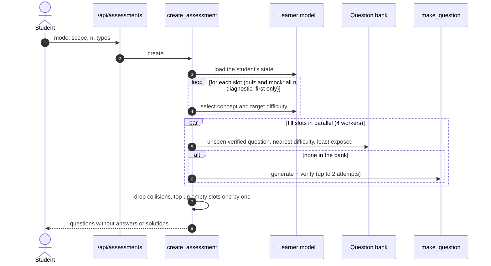

**No repeats:** `_unseen` excludes every question already served to that student in any assessment.
If a concept has no unseen question and none can be generated, the slot moves to the next-best
concept. A student is never shown the same question twice.

**Modes**

| Mode | Questions chosen | Feedback | Learning transition | Extra |
|---|---|---|---|---|
| Quiz | all up front from the current state | after each answer | yes | |
| Mock exam | all up front | only in the final report | yes | timer: 2 minutes per question |
| Diagnostic | one at a time, each after the previous answer | only in the final report | **no** (diagnosing, not teaching) | multiple choice, difficulty 2; marks the student as diagnosed |

### 9.4 Answering and reporting

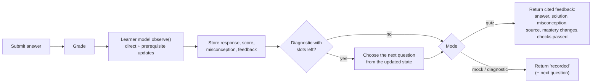

The **report** (`build_report`) contains:

- score and percentage;
- per concept: questions, accuracy, mastery before (from the event log) and after;
- per topic: accuracy;
- weak concepts (mastery after < 0.6);
- misconceptions with counts, labelled **likely** if seen at least twice and **possible** otherwise;
- root causes: weak tested concepts explained by a weaker prerequisite;
- next steps: for up to four weak concepts, the concept to study (the root cause if there is one)
  and the best-tagged unit to study it from;
- a review of every answered item with the answer, solution and cited source.

---

## 10. Learner model

`learner.py` is pure Python with no database or model dependency, so **the exact same code** runs
in the product and in the simulated-student evaluation.

### 10.1 State

Per student and concept: $p$ = probability the concept is mastered, $S$ = memory stability in
days, $t_{\text{last}}$ = time of the last evidence, and counts of attempts and correct answers.

### 10.2 Update rule

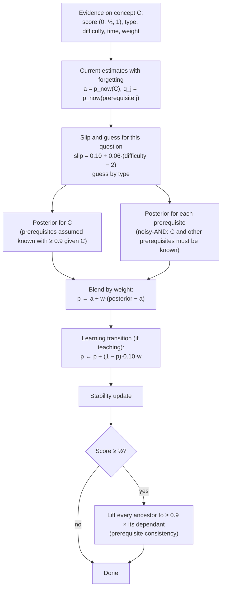

**1. Bayesian knowledge tracing.** With slip $s$ and guess $g$:

$$P(\text{known} \mid \text{correct}) = \frac{p\,(1-s)}{p\,(1-s) + (1-p)\,g} \qquad P(\text{known} \mid \text{wrong}) = \frac{p\,s}{p\,s + (1-p)\,(1-g)}$$

Guess depends on the question type, so the same correct answer is stronger evidence when guessing
is harder:

| Type | Guess $g$ |
|---|---|
| Multiple choice | 0.25 |
| Short answer | 0.08 |
| Numerical | 0.03 |

Slip is $0.10 + 0.06\,(d-2)$ for difficulty $d$, clamped to $[0.02, 0.4]$. Partial credit
$c$ mixes the two posteriors: $c \cdot P(\cdot \mid \text{correct}) + (1-c) \cdot P(\cdot \mid \text{wrong})$.

**2. Prerequisite structure.**

- *Attribution (noisy-AND).* A question on $C$ is answered correctly only if $C$ and its direct
  prerequisites are known:
  $$P(\text{correct}) = a\,(1-s) + (1-a)\,g, \qquad a = p_C \prod_{j} p_j$$
  So a wrong answer is evidence against $C$ *and* against any prerequisite that is already doubtful.
  With solid prerequisites this reduces exactly to plain BKT.
- *Consistency.* Knowing a concept implies knowing what it is built on. When updating $C$, its
  prerequisites are taken as known with probability at least 0.9, so a correct answer is credited to
  $C$ rather than explained away as a guess; and after a correct answer every ancestor is lifted to
  at least $0.9 \times$ its dependant's mastery. One correct answer deep in the graph therefore
  vouches for the whole chain beneath it, which is what lets a short diagnostic say something about
  dozens of concepts.
- *Structural prior.* A never-tested concept is discounted while its prerequisites look unknown:
  $p_{\text{now}} = p \cdot \big(0.5 + 0.5\,\text{readiness}\big)$, where readiness is the
  product of its prerequisites' mastery.

**3. Forgetting.**

$$p_{\text{now}}(t) = p \cdot e^{-(t - t_{\text{last}})/S}$$

| Event | Stability $S$ |
|---|---|
| First exposure (default) | 10 days |
| Correct on first sight (prior knowledge) | 30 days (10 × 3) |
| Later correct answer | × 1.8 (capped at 120 days) |
| Wrong answer | × 0.6 (at least 1 day) |
| Soft evidence (chat) | changes scaled by its weight |

**Learning transition:** after a practised question with feedback,
$p \leftarrow p + (1-p) \cdot 0.10 \cdot w$. This is standard BKT; a consequence is that a
very low estimate can rise slightly even after a wrong answer, reflecting learning from feedback.

### 10.3 Evidence sources and weights

| Source | Weight | Learning transition |
|---|---|---|
| Quiz or mock answer | 1.0 | yes |
| Diagnostic answer | 1.0 | no |
| Answer to a tutor check question | 0.5 | yes |
| Misconception voiced in chat | 0.3 (negative) | no |

### 10.4 Decisions driven by the model

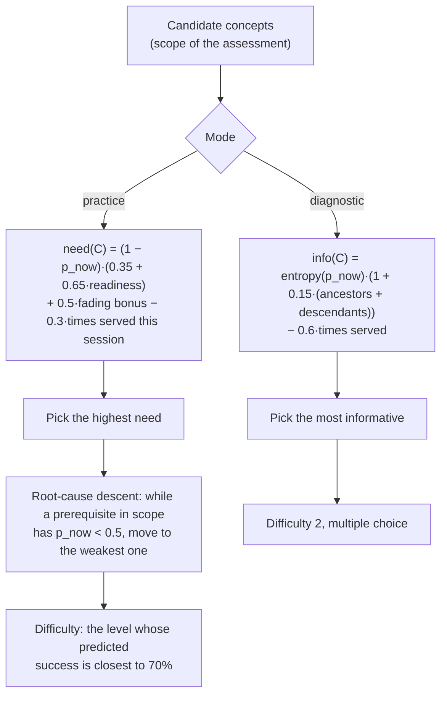

- **Next question:** practice mode targets low mastery weighted by readiness, revisits learned
  concepts as they fade, and descends to the weakest doubtful prerequisite. Diagnostic mode targets
  the concept whose answer says most about the whole graph.
- **Tutor:** the prompt receives the student's mastery of the concepts in play, weak prerequisites
  and observed misconceptions.
- **Dashboard and report:** weak concepts (< 0.6), mastered concepts (≥ 0.85), and root causes.
- **Schedule:** §11.1.

### 10.5 Cold start

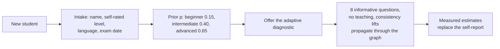

Until the diagnostic is taken, the dashboard says the estimates are self-reported.

---

## 11. Revision tools: schedule, flashcards, voice, languages

### 11.1 Study schedule

`schedule()` simulates forward day by day up to the exam (default two weeks if no date is set,
capped at 60 days), with 45 minutes a day in 15-minute blocks:

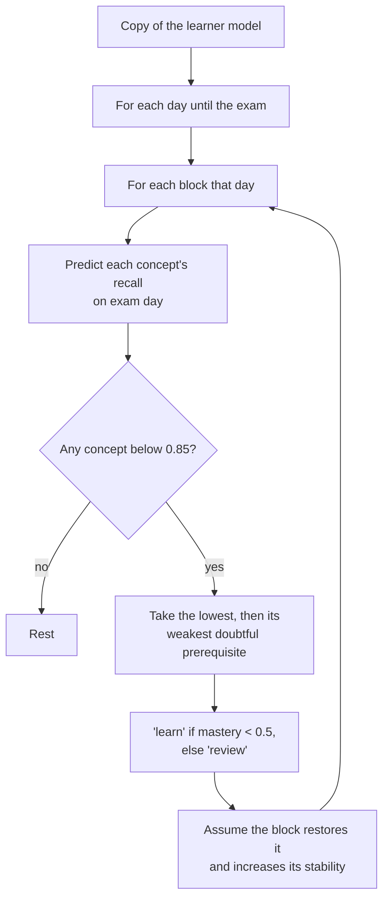

Because recall is predicted *at the exam*, concepts come back for review just before they would fade,
and foundations are scheduled before what depends on them.

### 11.2 Flashcards

For the student's weakest concepts (tested ones first), the generator writes cards from the
best-tagged units. Each card must carry a verbatim quote and is **kept only if the quote passes the
same quote check** as the tutor. If the student has shown a misconception on a concept, one card is
written to confront it. Cards are written in the student's language and can be read aloud.

### 11.3 Languages

Each student has a language setting: English, Hindi (Devanagari) or Hinglish. Non-English and
follow-up messages are first rewritten into an English search query, so retrieval works over the
English sources. Explanations, feedback and flashcards come back in the chosen language, while
**quotes stay in the original language of the source**, so citations still match exactly.

### 11.4 Voice

- **Speech input:** the browser's speech recognition (`en-IN`, or `hi-IN` for Hindi and Hinglish)
  fills the chat box.
- **Read-aloud:** answers and flashcards can be spoken with the browser's speech synthesis.

No audio leaves the browser for Pramāṇa's server; recognition is handled by the browser itself.

---

## 12. The web app

### 12.1 Page map

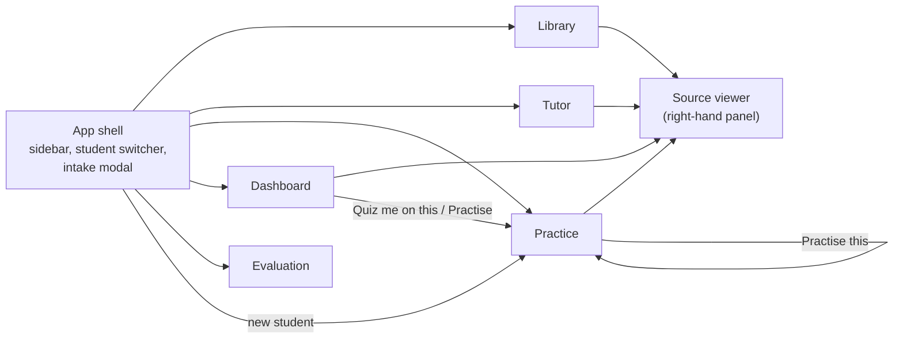

| Page | Contents |
|---|---|
| **Library** | Model status (which roles have keys); stat tiles (sources, units, figures, concepts, prerequisite links, slide-video links); add material (slide PDF, textbook PDF, YouTube URL or local video); load the default course; rebuild the concept map; live ingestion log; source list with a browser of every unit |
| **Tutor** | Chat with lanes and citation chips; quote-check count per answer; mastery-change chips; check questions; decline card with nearest material and an outside-knowledge option; speech input; read-aloud; suggested starter questions |
| **Practice** | Mode choice; scope by topic or concept, chips coloured by mastery; number of questions; question types. Runner with topic, concept and difficulty tags, mock-exam timer, skip. Cited feedback with the checks each question passed. Report with mastery bars (before marker and after fill), misconceptions, root causes, next steps and item review |
| **Dashboard** | Stat tiles; course flow map (columns = prerequisite depth, colour = mastery, grey = untested; click a node for its definition, mastery, stability, readiness, where it is taught, and "Quiz me on this"); focus list with root causes; mean-mastery trend; misconceptions seen; 14-day schedule; flashcards |
| **Evaluation** | Retrieval ablation, results by modality, refusal gate (held-out and threshold sweep), RAGAS section, simulation charts and tables, ablations, weekly-session condition, and every caveat |

### 12.2 Source viewer

| Unit origin | Viewer shows |
|---|---|
| Video timestamp | Embedded YouTube player starting at that second |
| Slide | The slide image cut from the PDF |
| Textbook page | The PDF opened at that page |
| Figure | Its parent's image, plus a warning that the text is an AI reading |

Below it: the unit's text with the cited quote highlighted, and buttons for the same moment in other
sources (slide ↔ video).

### 12.3 Front-end implementation

React 18 with Vite; no UI framework, a single hand-written stylesheet (`styles.css`) with a
responsive layout that collapses to one column below 980 px. `api.js` wraps `fetch` and surfaces
server error messages verbatim (for example "No API key for the generator model"). The selected
student is remembered in `localStorage`. In development, Vite proxies `/api` and `/files` to the
backend on port 8000; in production FastAPI serves the built files itself.

---

## 13. Data model

All state lives in one SQLite file, `data/pramana.sqlite`.

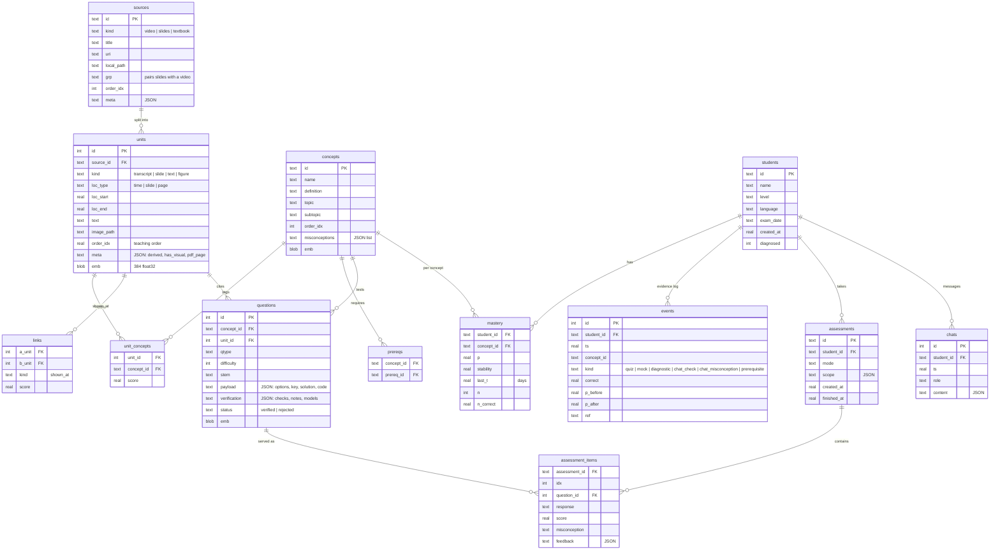

Two further tables: `jobs` (background ingestion jobs with status and a rolling log) and `kv`
(small values such as prerequisite-validation statistics and each student's pending check question).

Files on disk:

| Path | Contents |
|---|---|
| `data/raw/` | Downloaded and uploaded PDFs, uploaded videos, cached captions (`<id>.captions.json`) |
| `data/renders/<source>/` | Slide images (`slide_NNN.png`) and figure-page images (`page_NNNN.png`) |
| `data/cache/` | Model responses by content hash; the embedding model files |

---

## 14. Model roles and providers

`llm.py` exposes three **roles**, each configured as a `provider:model` string:

| Role | Used for | Configured by |
|---|---|---|
| **generator** | Tutor answers, question writing, concept graph, flashcards, outside-knowledge answers | `PRAMANA_GENERATOR` |
| **verifier** | Blind solving and judging of generated questions, short-answer grading, the RAGAS judge | `PRAMANA_VERIFIER` |
| **bulk** | Figure descriptions (vision), query rewriting | `PRAMANA_BULK` (defaults to the generator) |

**Providers:** `anthropic` (Claude, via the Anthropic SDK; JSON enforced with structured outputs)
and `google` (Gemini, via `google-genai`; JSON requested in the prompt, validated for required keys,
one retry on malformed output). If no role is configured, the code defaults to
`anthropic:claude-opus-5-5` (generator and bulk) and `anthropic:claude-sonnet-5-5` (verifier). The
shipped `.env.example` configures Gemini models instead.

**Cross-model validation:** the verifier should be a different model from the generator, ideally a
different family, so questions are not checked by the model that wrote them. `run_ragas.py` warns
if the two are the same.

All calls go through one function, `llm.ask(role, system, user, schema, images=…, cache=…)`.
Without credentials for a role, it raises `LLMUnavailable`, which the API returns as HTTP 503 with
a message naming the missing key; the UI shows that message. A plain-text variant, `llm.text`, is
used only by the RAGAS judge.

---

## 15. Installation and setup

### 15.1 Requirements

- Python 3.11 or later (developed on 3.13)
- Node.js 18 or later (for building the web app)
- An API key for at least one provider (Gemini or Anthropic) for the model stages
- About 600 MB of disk: course PDFs, renders, the embedding model and Python packages
- Internet access during ingestion (course material, captions, the embedding model download)

### 15.2 Step by step

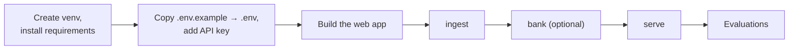

**1. Python environment**

```bash
python -m venv .venv
```

```bash
.venv\Scripts\activate
```

On macOS or Linux use `source .venv/bin/activate`.

```bash
pip install -r requirements.txt
```

**2. Configuration.** Copy `.env.example` to `.env` and fill in your key (see §16):

```bash
copy .env.example .env
```

**3. Web app**

```bash
cd frontend
```

```bash
npm install
```

```bash
npm run build
```

```bash
cd ..
```

**4. Ingest the course.** From the `backend` folder:

```bash
cd backend
```

```bash
python -m pramana.cli ingest
```

This downloads and parses all sources, embeds them, reads figures, aligns slides to videos, builds
the concept map and tags every unit. Expect a few minutes for parsing and embedding, plus the time
for about 125 vision calls.

**5. Pre-generate questions (optional but recommended for demos)**

```bash
python -m pramana.cli bank --per-concept 2
```

**6. Run the app**

```bash
python -m pramana.cli serve
```

Open http://127.0.0.1:8000. Use `--port 8001` if port 8000 is busy.

**7. Run the evaluations** from the project root (§19).

### 15.3 Development mode (hot reload)

Run the API on port 8000 with `python -m pramana.cli serve`, then in `frontend`:

```bash
npm run dev
```

Vite serves the app on http://localhost:5173 and proxies API calls to port 8000.

### 15.4 Without an API key

Parsing, embeddings, search, slide-to-video alignment, the refusal gate for off-topic questions,
the Library and Evaluation pages, `run_retrieval_eval.py`, `simulate.py` and the test suite all work
without a key. Figure reading, the concept map, tutor answers, question generation, flashcards and
`run_ragas.py` need one; the UI says so instead of failing silently.

---

## 16. Configuration reference

All settings are environment variables, read from `.env` at start-up.

| Variable | Default | Purpose |
|---|---|---|
| `GEMINI_API_KEY` or `GOOGLE_API_KEY` | none | Credentials for `google:` roles |
| `ANTHROPIC_API_KEY` | none | Credentials for `anthropic:` roles |
| `PRAMANA_GENERATOR` | `anthropic:claude-opus-5-5` | Generator model |
| `PRAMANA_VERIFIER` | `anthropic:claude-sonnet-5-5` | Verifier and judge model; should differ from the generator |
| `PRAMANA_BULK` | same as generator | Vision and query-rewrite model |
| `PRAMANA_EMBED_MODEL` | `BAAI/bge-small-en-v1.5` | Local embedding model (any `fastembed` model) |
| `PRAMANA_COVERAGE_THRESHOLD` | `0.72` | Coverage-gate threshold; fitted by `run_retrieval_eval.py`, results flat from 0.70 to 0.75 |
| `PRAMANA_MAX_FIGURE_PAGES` | `60` | Cap on textbook pages sent for figure reading |
| `PRAMANA_DATA` | `<project>/data` | Where the database, downloads, renders and caches live |

Model availability depends on your provider account. If a model id is not available to your key,
the first model call fails with the provider's error, shown in the ingestion log or the UI.

Changing `PRAMANA_EMBED_MODEL` requires re-ingesting (embeddings are stored with the units).

---

## 17. Command-line reference

Run from the `backend` folder: `python -m pramana.cli <command>`.

| Command | What it does |
|---|---|
| `ingest` | For every source in `course.yaml`: fetch, parse and store units (skipping sources already present), then run all enrichment stages. A source that fails to fetch is logged and the rest continue. |
| `ingest --force` | Re-ingest every source from scratch and rebuild the concept map |
| `ingest --only ID [ID …]` | Ingest only the listed sources |
| `enrich` | Re-run enrichment on what is already stored: embed new units, read figures not yet read, align slides, build the concept map if missing, tag units |
| `enrich --rebuild-graph` | Same, but rebuild the concept map and re-validate prerequisites |
| `bank --per-concept N [--types mcq numeric short]` | Generate and verify questions until each concept has N verified ones; prints the gate statistics |
| `stats` | Knowledge-base summary: sources, units by kind, concepts, prerequisite edges and validation counts, slide-video links, questions by status |
| `serve [--host 127.0.0.1] [--port 8000]` | Start the API and the web app |

---

## 18. HTTP API reference

Base URL `http://127.0.0.1:8000`. All bodies are JSON unless noted.

**Knowledge base**

| Method | Path | Description |
|---|---|---|
| GET | `/api/status` | Model roles and whether each has a key; knowledge-base statistics; coverage threshold |
| GET | `/api/sources` | Sources with unit and figure counts |
| GET | `/api/sources/{source_id}/units` | Every unit of a source, in order |
| GET | `/api/units/{unit_id}` | One unit with label, open target, concepts and cross-modal links |
| GET | `/api/search?q=…&k=8` | Hybrid search; units with similarity scores |
| POST | `/api/ingest/course` | Background job: ingest `course.yaml`. Returns `{job_id}` |
| POST | `/api/ingest/upload` | Multipart form: `kind` (`slides`, `textbook`, `video`), `title`, and `file` or `youtube_url`. Background job |
| POST | `/api/ingest/rebuild-graph` | Background job: rebuild the concept map |
| GET | `/api/jobs/{job_id}` | Job status, progress message and log |

**Students and learner model**

| Method | Path | Description |
|---|---|---|
| GET | `/api/students` | All students |
| POST | `/api/students` | Create: `{name, level, language, exam_date}` |
| PATCH | `/api/students/{id}` | Update the same fields |
| GET | `/api/graph?student_id=…` | Concept map nodes and edges; with a student, mastery, attempts, stability and readiness per node |
| GET | `/api/concepts/{concept_id}/units?k=6` | Where a concept is taught |
| GET | `/api/students/{id}/dashboard` | Mean mastery, mastered and weak concepts, root causes, mastery trend, misconceptions, recent assessments |

**Tutor**

| Method | Path | Description |
|---|---|---|
| POST | `/api/chat` | `{student_id, message, allow_outside}`. Returns status (`answered`, `declined`, `outside`), lanes with citations, check question, mastery updates, quote-check counts and retrieval details |
| GET | `/api/students/{id}/chat` | Last 40 chat messages |

**Assessment**

| Method | Path | Description |
|---|---|---|
| POST | `/api/assessments` | `{student_id, mode, concept_ids, n, types}`. `n` is clamped to 1-30; empty `concept_ids` means the whole course. Returns questions without answers |
| POST | `/api/assessments/{id}/answer` | `{idx, response}`. Quiz: cited feedback. Mock and diagnostic: `{recorded, next}` |
| GET | `/api/assessments/{id}/report` | The full report (§9.4); marks the assessment finished |
| GET | `/api/bank` | Generated, verified and rejected counts, pass rate, rejections by check |

**Revision and evaluation**

| Method | Path | Description |
|---|---|---|
| GET | `/api/students/{id}/flashcards` | Cited flashcards for weak concepts |
| GET | `/api/students/{id}/schedule?minutes_per_day=45` | Day-by-day plan to the exam date |
| GET | `/api/eval` | Every JSON file in `eval/results/` |

**Static files**

| Path | Serves |
|---|---|
| `/files/raw/…` | Downloaded PDFs (for the viewer) |
| `/files/renders/…` | Slide and page images |
| `/` and any other path | The built web app |

**Errors:** 404 for unknown ids; 409 if an assessment is requested before a concept map exists;
502 for a provider error; 503 when a needed model has no key or no questions can be produced.

---

## 19. Evaluation

Three evaluations, each a script in `eval/` that writes JSON to `eval/results/`. The app's
Evaluation page renders those files, including their caveats. Full write-up:
[docs/EVALUATION.md](docs/EVALUATION.md).

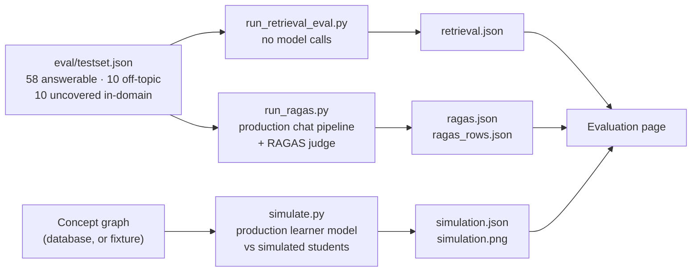

### 19.1 Current status

| Evaluation | Status |
|---|---|
| Retrieval and refusal gate | **Run** |
| Simulated students | **Run**, on the hand-written stand-in concept graph (`eval/fixtures/probability_graph.json`), because the extracted graph needs a model key. Re-run after ingestion with a key. |
| RAGAS and grounding | **Not run yet.** Needs model keys. No numbers are claimed. |

The model-dependent stages (figure reading, concept-graph extraction, question generation and
verification, tutor answers) have not yet been evaluated against a real model; their surrounding
code is exercised by scripted tests (§20).

### 19.2 Test set

`eval/testset.json`, written by hand for the default course:

- **58 answerable questions**, each with a reference answer and gold source locations: 37 anchored
  on slides, 16 textbook-only, 2 video-anchored, 3 about figures.
- **10 off-topic questions** (transformers, photosynthesis, TCP vs UDP, …).
- **10 in-domain questions the material does not cover** (Chebyshev's inequality, moment generating
  functions, the Poisson *process*, …), each confirmed absent by keyword search: the hard negatives.

Gold locations were found by reading the slides and keyword-searching the textbook and captions,
not with the retriever. After the first run, four questions with no gold hit were judged by hand;
the retrieved passages did answer them, so those locations were added (pooled judging, disclosed in
the file). Before that correction, hybrid hit@8 was 0.931.

### 19.3 Retrieval and refusal (`run_retrieval_eval.py`)

| Retriever | hit@1 | hit@3 | hit@8 | MRR | gold-source recall |
|---|---|---|---|---|---|
| **Hybrid (used)** | 0.621 | 0.845 | 1.000 | 0.757 | 0.879 |
| Dense only | 0.621 | 0.793 | 0.983 | 0.741 | 0.879 |
| BM25 only | 0.517 | 0.828 | 0.897 | 0.662 | 0.799 |

By where the answer lives (hybrid): slides hit@1 0.568, textbook 0.750, video 0.500 (n = 2),
figures 0.667 (n = 3); all found by rank 8.

**Refusal gate** (first layer only). The threshold is fitted on half the questions and scored on
the other half:

| | Answerable passed | Off-topic declined | Uncovered in-domain declined |
|---|---|---|---|
| Held-out half, threshold 0.735 | 100% | 100% | 80% |
| All 78 questions | 100% | 90% | 60% |
| All, without the rare-term rescue | 89.7% | 100% | 90% |

### 19.4 Generation quality (`run_ragas.py`)

Runs the production chat pipeline on every test question and reports:

- **RAGAS** on answerable questions: faithfulness, answer relevancy, context precision (with
  reference) and context recall. The judge is the verifier role, called through Pramāṇa's own model
  layer (so no unsupported sampling parameters are sent); embeddings are the same local model.
- **Grounding:** quote-check pass rate; shares of source-backed, outside and unverified segments;
  share of verified citations landing on a gold location; answerable questions wrongly declined; and
  refusal precision and recall over off-topic and uncovered questions (both layers together).

Per-question rows go to `eval/results/ragas_rows.json` for hand-checking the judge. Use
`--limit N` for a cheap trial run.

### 19.5 Personalisation (`simulate.py`)

30 simulated students (5 profiles: novice, average, gaps in prerequisites, forgetful, strong
reviser; × 6 seeds). Each has a hidden binary knowledge state per concept, its own slip, learning
and forgetting rates, and two seeded misconceptions. 8 sessions of 10 questions, 2 days apart.
Every policy meets the identical students. The script uses `learner.py` unmodified.

```mermaid
flowchart LR
    ST["Simulated student<br/>(hidden truth)"] -->|"answers by its own state"| POL["Policy picks question"]
    POL -->|"Pramāṇa / random / syllabus"| ST
    ST -->|"learns from feedback,<br/>forgets between sessions"| ST
    POL --> LM["Learner model estimate"]
    LM -->|"compared with hidden truth"| MET["Mastery gain · RMSE · AUC<br/>repetition · in-zone · misconceptions"]
```

| Policy | Mastery gain | Pramāṇa minus this (95% CI) | Repetition rate |
|---|---|---|---|
| **Pramāṇa** | **+0.118** | | 0.0% |
| Random questions | +0.010 | +0.108 [+0.069, +0.148] | 8.3% |
| Syllabus order | +0.036 | +0.081 [+0.036, +0.125] | 0.0% |
| Pramāṇa without prerequisite structure | +0.099 | +0.019 [−0.016, +0.053] | 0.0% |
| Pramāṇa without forgetting | +0.121 | −0.003 [−0.044, +0.034] | 0.0% |

Estimate error against the hidden truth falls from RMSE 0.449 (AUC 0.56) before any data to 0.394
(AUC 0.77) after 8 sessions, improving through session 4 and then plateauing.

**What did not work, reported as found:**

- Modelling forgetting did not improve estimate accuracy (RMSE 0.366 without it vs 0.394 with it).
- The prerequisite structure improves estimates (0.425 → 0.394) and targeting, but its effect on
  mastery gain has an interval that includes zero.
- Misconception detection from distractor choice alone was poor (recall 0.27, precision 0.16).
- With weekly sessions every policy lost mastery; Pramāṇa lost least (−0.043 vs −0.118 random).

**How much weight these numbers bear:** the students are simulated, so this shows the system
behaves as designed under stated assumptions, not that real students learn more. The simulated
world shares the learner model's assumption about prerequisites, which favours it. The zero
repetition rate is a property of the selector, not a finding. The learner model was revised during
development after looking at these results.

### 19.6 Running them

From the project root:

```bash
python eval/run_retrieval_eval.py
```

```bash
python eval/simulate.py
```

```bash
python eval/run_ragas.py
```

`simulate.py` accepts `--graph auto|db|fixture`, `--students-per-profile`, `--sessions` and
`--questions`.

---

## 20. Testing

```bash
python -m pytest tests -q
```

24 tests, no network or API key needed (the embedding model must have been downloaded once).

| File | What it pins |
|---|---|
| `tests/test_learner.py` | Correct answers raise and wrong answers lower mastery; guessable questions are weaker evidence; wrong answers implicate doubtful prerequisites; reduction to plain BKT with solid prerequisites; consistency lifts the whole chain; forgetting and the spacing effect; the structural prior; selection descends to the root cause; difficulty tracks mastery; the schedule respects time budgets and prerequisite order |
| `tests/test_checks.py` | Quote check (exact, spacing, near-verbatim, rejection, minimum length); sandbox exact and simulated results; sandbox refusals; numeric parsing; MCQ and numeric grading; transcript windows; YouTube URL parsing |
| `tests/test_pipeline.py` | End to end with scripted model responses: off-topic decline without a model call; a fabricated quote demoted to unverified while a real one is cited; a chat check question updating mastery; the gate rejecting a wrong key (code mismatch), a disagreeing verifier and an invented quote; a quiz served from the bank, graded, reported, and never repeated |

The scripted tests replace only `llm.ask`; they verify the plumbing, not model quality.

---

## 21. Repository layout

```
Pramana/
├── README.md                     this file
├── course.yaml                   default course manifest
├── requirements.txt              Python dependencies
├── .env.example                  configuration template (copy to .env)
├── backend/pramana/
│   ├── config.py                 paths and environment settings
│   ├── db.py                     SQLite schema and access
│   ├── llm.py                    model roles, providers, JSON schemas, cache
│   ├── embed.py                  embeddings, BM25, hybrid search, rare terms
│   ├── service.py                unit views, graph and learner loading, update persistence
│   ├── grounding.py              tutor: rewrite, coverage gate, lanes, quote-lock
│   ├── learner.py                learner model and schedule (pure Python)
│   ├── extras.py                 flashcards, study schedule endpoint logic
│   ├── api.py                    FastAPI app, background jobs, static hosting
│   ├── cli.py                    ingest, enrich, bank, stats, serve
│   ├── ingest/
│   │   ├── parse.py              videos, slides (handout detection), textbooks; no LLM
│   │   ├── enrich.py             figures, alignment, concept graph, tagging, validation
│   │   └── pipeline.py           fetch, store, orchestrate, auto-pair
│   └── assess/
│       ├── generate.py           evidence selection, generation, bank, assessment assembly
│       ├── verify.py             verification gate, grading, number parsing
│       ├── sandbox.py            AST-screened execution of checking code
│       └── report.py             answer handling and reports
├── frontend/
│   ├── index.html, vite.config.js, package.json
│   └── src/
│       ├── main.jsx, App.jsx     shell, navigation, intake
│       ├── api.js                fetch wrapper, mastery colours, speech
│       ├── SourceViewer.jsx      exact-origin viewer with quote highlighting
│       ├── styles.css
│       └── pages/                Library, Tutor, Practice, Dashboard, Evaluation
├── eval/
│   ├── testset.json              team-built test set
│   ├── run_retrieval_eval.py     retrieval and refusal gate
│   ├── run_ragas.py              RAGAS and grounding metrics
│   ├── simulate.py               simulated-student study
│   ├── fixtures/probability_graph.json
│   └── results/                  JSON results and charts
├── tests/                        pytest suite
├── docs/
│   ├── ARCHITECTURE.md           design notes
│   ├── EVALUATION.md             evaluation report
│   ├── DEMO_SCRIPT.md            shot list
│   └── DEMO_TRANSCRIPT.md        narration for the demo video
└── data/                         created at run time (ignored by git)
```

---

## 22. Security and privacy notes

- **API keys** live only in `.env`, which is git-ignored. Never commit it.
- **Generated code** runs only after an AST allow-list check, in a separate interpreter, in a
  temporary directory, with a timeout. This prevents accidents, not deliberate escape attempts;
  do not expose the question-generation path to untrusted users without stronger isolation.
- **Static serving** is limited to `data/raw` and `data/renders`; the database file is not served.
- **Local by default:** the server binds to 127.0.0.1. There is no authentication, so do not expose
  it to a network as-is.
- **Student data** (names, answers, chat) stays in the local SQLite file. Chat messages and course
  excerpts are sent to the configured model provider to generate answers.
- **Voice** is processed by the browser's own speech services.
- **Uploaded files** are stored under `data/raw`; only PDFs are accepted for slides and textbooks.

---

## 23. Troubleshooting

| Symptom | Cause and fix |
|---|---|
| `[Errno 10048] … only one usage of each socket address` on `serve` | Something already uses port 8000. Stop it, or run `serve --port 8001`. |
| Library shows "no key" for a role | The matching key is missing from `.env`, or the server was started before you added it. Add it and restart. |
| "No API key for the … model" in the UI | Same as above, for the role named in the message. |
| Model-not-found or permission error on the first model call | The model id in `.env` is not available to your account. Change `PRAMANA_GENERATOR`, `PRAMANA_VERIFIER` or `PRAMANA_BULK`. |
| Rate-limit errors during `enrich` or `bank` | Common on free tiers. Re-run the same command: model responses during ingestion are cached, so it resumes. |
| `YouTube is blocking requests from your IP` | Too many transcript requests in a short time. Pramāṇa retries and falls back to `yt-dlp`; if both fail, wait and re-run `ingest` (completed sources are skipped). |
| "No concept graph yet" when starting a quiz | Run `python -m pramana.cli enrich` with a generator key. |
| A quiz takes a minute to start | The bank is empty for that scope, so questions are generated and verified live. Run `bank` first. |
| Fewer questions than requested | Generation failed the gate for some slots, or the scope ran out of unseen questions. See `/api/bank` for rejection reasons. |
| The web app shows a blank page | The front end was not built. Run `npm run build` in `frontend`. |
| `ModuleNotFoundError: langchain_community.chat_models.vertexai` | Incompatible LangChain version for RAGAS 0.4.3. Reinstall with `pip install -r requirements.txt` (pins `langchain-community<0.4`). |
| Hugging Face symlink warnings on Windows | Harmless; the embedding model still caches correctly. |

---

## 24. Known limitations

- **Quote-lock verifies quotes, not reasoning.** A citation is guaranteed to exist where it points;
  the sentence built on it can still overreach. RAGAS faithfulness is the measure for that.
- **Figure text is model-written.** It is the one exception to verbatim units, and it is labelled.
- **Concept tagging is by embedding similarity** and has not been evaluated separately.
- **The Gemini path enforces JSON by prompt**, not by schema, so malformed responses are more likely
  than with structured outputs (one retry is made).
- **The sandbox is not a security boundary** against hostile code.
- **No authentication or multi-user deployment**; it is a local, single-machine prototype.
- **Evaluation gaps:** RAGAS has not been run; the simulation used a stand-in graph; the refusal
  gate's rare-term rule was designed while looking at the test set; the test set is small.
- **Simulated students are not real students.** Learning gains with real learners are unmeasured.
- **Misconception detection** from distractor choice alone was unreliable in simulation.

---

## 25. Roadmap

- Run RAGAS and the simulation on the extracted concept graph, and publish the numbers.
- A pilot with real students to measure learning gains directly.
- Misconception detection from free-text explanations, not just option choice.
- Fit forgetting parameters per student, or drop the component if it still adds nothing.
- OCR for scanned textbooks and handwritten notes; more Indian languages.
- Fully spoken tutoring sessions.
- Authentication and a multi-user deployment.

---

## 26. Licences and credits

- **MIT OpenCourseWare 6.041SC**, *Probabilistic Systems Analysis and Applied Probability*,
  Fall 2013, licensed CC BY-NC-SA 4.0.
- **Charles M. Grinstead and J. Laurie Snell**, *Introduction to Probability*, distributed under the
  GNU Free Documentation License.

Pramāṇa downloads this material at run time for personal study and does not redistribute it.

Built with Python, FastAPI, SQLite, PyMuPDF, fastembed, rank-bm25, SymPy, youtube-transcript-api,
yt-dlp, the Anthropic and Google GenAI SDKs, RAGAS, React and Vite.
